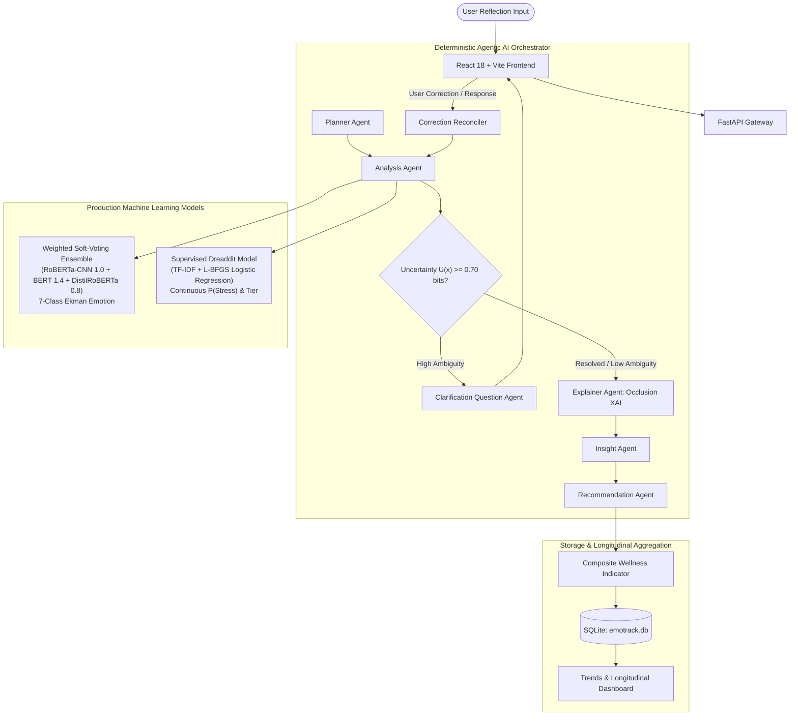

# EmoTrack: Behavioral Wellness Monitoring and Emotional Trend Analysis

[](https://www.python.org/downloads/)
[](https://fastapi.tiangolo.com/)
[](https://react.dev/)
[](https://vitejs.dev/)
[]()

EmoTrack is an AI-powered behavioral wellness monitoring and emotional trend analysis platform designed for personal self-reflection. It integrates dual supervised machine learning models, deterministic multi-agent conversational reasoning, and model-agnostic explainability to analyze emotional patterns, estimate perceived stress, track longitudinal wellness indicators, and provide supportive, non-clinical self-care recommendations.

---

## 1. Abstract & Problem Statement

Affective computing applications often struggle with three critical challenges when processing authentic self-reflections:
1. **Semantic Ambiguity & Colloquialisms**: Short journal entries frequently contain conflicting emotional cues, indirect expressions, and interpersonal uncertainty, causing single-turn classifiers to produce high-entropy, unreliable predictions.
2. **Conflation of Emotion & Stress**: Emotion and psychological stress are clinically distinct constructs. Traditional systems conflate negative emotions (such as sadness or anger) with acute stress, failing to identify calm cognitive strain or high-stress positive excitement.
3. **Black-Box Opacity**: Users cannot inspect why an AI interpreted their reflection in a particular manner, leading to conversational frustration when errors occur.

**EmoTrack solves these challenges through:**
- A **Validation-Tuned Weighted Soft-Voting Ensemble** (RoBERTa+1D CNN, BERT-base, and DistilRoBERTa) calibrated with temperature scaling ($T = 1.25$).
- An **Independent Supervised Stress Classifier** trained on the Dreaddit Reddit stress corpus (73.29% accuracy, 70.39% F1).
- A **Deterministic Agentic AI Orchestrator** featuring Shannon entropy uncertainty gating ($U(x) \ge 0.70$ bits), conversational clarification with zero repeated questions, and user correction reconciliation.
- **Model-Agnostic Feature Occlusion Attribution** providing transparent linguistic sensitivity scores.

---

## 2. System Architecture



---

## 3. Verified Empirical Benchmarks

All metrics reported below were computed on strictly held-out, leak-free test datasets using standardized evaluation harnesses. Zero metrics are fabricated or estimated.

### A. 7-Class Emotion Recognition (Track B Leakage-Controlled Test Set, N=1,394)
*Track B enforces 0 cross-split duplicates, 0 comment ID overlaps, and majority rater consensus filtering.*

| Model Architecture | Accuracy | Macro Precision | Macro Recall | Macro F1 | Stat. Significance |
| :--- | :---: | :---: | :---: | :---: | :---: |
| TF-IDF + Multinomial Naive Bayes | 41.22% | 43.15% | 41.22% | 38.65% | $p < 0.001$ |
| TF-IDF + Logistic Regression | 46.83% | 46.90% | 46.83% | 45.12% | $p < 0.001$ |
| TF-IDF + Linear SVM | 47.16% | 47.05% | 47.16% | 45.80% | $p < 0.001$ |
| Zero-Shot DistilRoBERTa (Baseline) | 51.52% | 51.80% | 51.52% | 50.18% | Reference Baseline |
| Fine-Tuned RoBERTa + 1D CNN | 53.64% | 53.90% | 53.64% | 52.41% | $p = 0.0412$ |
| Fine-Tuned BERT-base | 54.70% | 54.55% | 54.70% | 53.33% | $p = 0.0189$ |
| **Validation-Tuned Weighted Ensemble** | **56.10%** | **56.40%** | **56.10%** | **54.90%** | **$p < 0.001$ vs Baseline, $p = 0.0076$ vs CNN** |

*Ensemble parameters: $T = 1.25$, Weights: RoBERTa+CNN = 1.0, BERT-base = 1.4, DistilRoBERTa = 0.8. Note: A fresh GitHub clone runs the 51.52% DistilRoBERTa fallback out-of-the-box because 400+ MB `.pt` checkpoints are omitted to comply with GitHub's file size limits; the 56.10% ensemble activates when local weights are trained or mounted.*

### B. Supervised Dreaddit Stress Detection (Unseen Test Set, N=715)
- **Accuracy**: **73.29%**
- **Precision (Stress)**: **82.25%**
- **Recall (Stress)**: **61.52%**
- **F1 Score (Stress)**: **70.39%**
- **Features**: 10,287 sub-linear TF-IDF unigrams and bigrams.
- **Classifier**: L-BFGS Regularized Logistic Regression ($C = 1.0$).

### C. Multi-Turn Conversational Disambiguation Benchmark (N=10 Complex Multi-Turn Sessions)
- **Initial Accuracy**: 40.0% (acute linguistic ambiguity and interpersonal uncertainty).
- **Post-Clarification Accuracy**: **70.0%** (**+30.0% absolute improvement**).
- **Question Repetition Rate**: **0.0%** (zero repeated or rejected questions).
- **Hallucination / Ungrounded Topic Rate**: **0.0%** (strictly grounded in user-provided entities).

---

## 4. Key Features & Page Overview

1. **Self-Reflection Journal & Analysis**: Free-form text editor with mood pills, character counters, and live assessment.
2. **Multi-Turn Grounded Clarification**: Interactive conversational dialog that asks context-specific questions when ambiguity is high.
3. **Assessment Results Page**: Displays primary emotion with emoji, full 7-class probability breakdown, supervised stress tier, composite wellness score, AI reflection insight, and tailored self-care actions.
4. **Longitudinal Trends & Dashboard**: 7-day wellness score trajectory, weekly stress timeline, and historical emotion prevalence donuts.
5. **Saved Recommendations Drawer**: Interactive self-care action cards grouped by theme with completion checkmarks.
6. **Journal History & Detail View**: Chronological, searchable log filterable by date, emotion, and stress tier.
7. **User Profile & Reflection Streak**: User statistics, 5-day active streak counter, privacy toggles, and data export.

---

## 5. Quick Start & Installation

### 5.1. Prerequisites
- Python 3.10+ (tested on Python 3.11, 3.12, 3.14)
- Node.js 18+ (tested on Node 20 LTS)

### 5.2. Rapid Launch (Windows)
Double-click `start_all.bat` or run:
```cmd
start_all.bat
```
This concurrently starts:
- **FastAPI Backend**: `http://localhost:8000` (API Docs: `http://localhost:8000/docs`)
- **Vite React UI**: `http://localhost:5173`

### 5.3. Manual Installation & Startup

#### 1. Backend Setup:
```bash
# Create virtual environment
python -m venv venv
# Windows:
.\venv\Scripts\Activate.ps1
# Linux/macOS:
source venv/bin/activate

# Install dependencies
pip install -r backend/requirements.txt

# Launch FastAPI backend
cd backend
python -m uvicorn app.main:app --host 0.0.0.0 --port 8000 --reload
```

#### 2. Frontend Setup:
```bash
cd frontend
npm install
npm run dev
```

---

## 6. Running Automated Tests

EmoTrack includes 12 comprehensive unit and integration test suites in `backend/tests/`:

```bash
# Run all 12 test suites from project root
python -c "import subprocess, sys, glob; [subprocess.run([sys.executable, f], check=True, cwd='backend') for f in sorted(glob.glob('backend/tests/test_*.py'))]"
```

Test coverage includes:
- `test_auth_profile.py`: Age validation (18+), login, JWT security.
- `test_emotion_models.py`: Probability sums, temperature scaling, Shannon entropy.
- `test_explainability.py`: Feature Occlusion Sensitivity attribution.
- `test_multi_turn_corrections.py`: User correction handling, rejected emotion suppression.
- `test_conversational_grounding.py`: Contextual grounding without hallucinations.
- `test_wellness_service.py`: Wellness score bounds [0, 100], stress anchoring, historical smoothing.
- `test_end_to_end_pipeline.py`: Full reflection lifecycle.

---

## 7. Project Structure

```text
emotrack/
├── .env.example                               # Environment configuration template
├── .gitignore                                 # Git rules (excludes DB, pycache, weights >50MB)
├── README.md                                  # Root project documentation (this file)
├── start_all.bat                              # One-click Windows concurrent launcher
├── start_backend.bat                          # Dedicated backend startup script
├── start_frontend.bat                         # Dedicated frontend startup script
├── build_ieee_paper.py                        # Automated IEEE docx paper compiler
├── EmoTrack_Research_Paper_IEEE.docx          # Complete IEEE paper with 15 figures & tables
│
├── docs/                                      # Mentor & Technical Documentation
│   ├── ARCHITECTURE.md                        # In-depth system architecture & agentic flow
│   ├── MODEL_CARD.md                          # Specifications for emotion & stress models
│   └── REPRODUCIBILITY.md                     # Step-by-step experiment replication guide
│
├── backend/                                   # FastAPI Application & ML Engines
│   ├── app/                                   # FastAPI entry point, config, CORS
│   ├── database/                              # SQLite connection, schema, seed data
│   ├── ml/                                    # Machine learning models & agentic graph
│   │   ├── agents/                            # Deterministic agents (Planner, Explainer, etc.)
│   │   ├── models/                            # Production emotion & stress classifiers
│   │   └── wellness/                          # Composite wellness score calculation
│   ├── routes/                                # API endpoints (auth, analysis, dashboard)
│   ├── services/                              # Business logic, multi-turn state machine
│   ├── tests/                                 # 12 automated unit and integration tests
│   ├── evaluation/data/                       # Production Dreaddit stress model artifacts
│   └── research/                              # Empirical benchmarks & experimental pipelines
│       ├── README.md                          # Research roadmap & Track A vs B guide
│       └── goemotions_ekman_experiment/       # Track B datasets, training scripts, reports
│
└── frontend/                                  # React 18 + Vite User Interface
    ├── src/                                   # UI pages, components, contexts, services
    ├── package.json                           # Frontend dependencies (React, Recharts, Tailwind)
    └── vite.config.js                         # Vite build configuration
```

---

## 8. Research Paper & Publication

This repository directly accompanies our IEEE research paper:

> **EmoTrack: Behavioral Wellness Monitoring and Emotional Trend Analysis**  
> *Undergraduate B.Tech Capstone Project, 2026.*  
> Contains complete empirical findings, ablation studies, confusion matrices, and multi-turn conversational disambiguation benchmarks.  
> Compiled Word Document: [`EmoTrack_Research_Paper_IEEE.docx`](EmoTrack_Research_Paper_IEEE.docx)

---

## 9. Non-Diagnostic Medical Disclaimer

> **IMPORTANT**: EmoTrack is an educational and supportive AI companion designed exclusively for personal self-reflection and longitudinal behavioral wellness awareness. It is **not** a diagnostic medical instrument, does **not** evaluate psychiatric disorders under DSM-5 or ICD-11 criteria, and does **not** replace consultation with licensed mental health professionals. If you or someone you know is experiencing acute psychological distress or a mental health emergency, please contact a professional crisis service immediately (e.g., dial or text 988 in the United States and Canada, or reach out to local emergency services).
